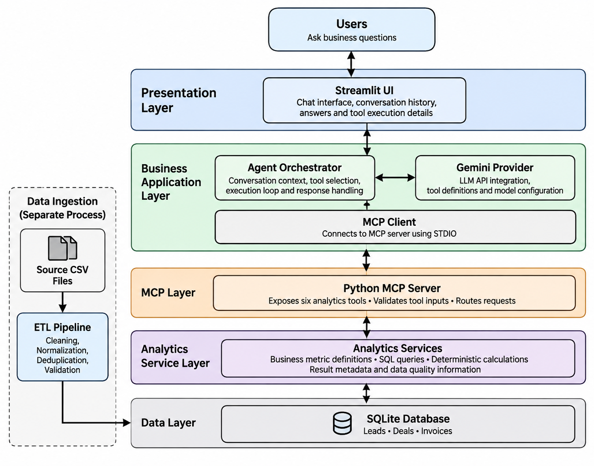

# AI Business Analyst

An AI-powered business analyst that enables users to explore CRM data, ask business questions in natural language and receive data-driven insights through an LLM-powered agent.

The application combines deterministic analytics with AI-based question interpretation and explanation. It uses the Model Context Protocol (MCP) to expose analytical capabilities to the agent, keeping business calculations independent of the LLM.

## Key Features

- **Natural Language Querying:** Ask business questions without writing SQL or interacting directly with the database.
- **Business Performance Analysis:** Analyse revenue, win rates, sales performance, pipeline health and invoice collections.
- **Tool-Based Analytics:** Uses six predefined analytical tools exposed through an MCP server.
- **Explainable Responses:** Displays tool execution details, including tool names, input arguments and returned results.
- **Deterministic Calculations:** Business metrics are calculated using predefined SQL queries and Python logic rather than generated by the LLM.
- **Conversational Interface:** Supports follow-up questions through a Streamlit chat interface.
- **Model Configuration:** Keeps LLM integration separate from analytics and tool execution logic.

## Architecture

The application follows a layered architecture with five main layers:

1. **Presentation Layer:** Streamlit chat interface.
2. **Business Application Layer:** Agent orchestrator, Gemini provider and MCP client.
3. **MCP Layer:** Python MCP server exposing analytical tools.
4. **Analytics Service Layer:** Business metric definitions, SQL queries and deterministic calculations.
5. **Data Layer:** SQLite database containing leads, deals and invoices.

A separate ETL pipeline prepares and validates the source CSV files before loading them into the database.



For a detailed explanation of the architecture, component responsibilities and end-to-end workflow, refer to [Technical Documentation](docs/documentation.md).

## Technology Stack

| Component | Technology |
|---|---|
| Programming Language | Python |
| User Interface | Streamlit |
| LLM | Google Gemini API |
| Agent Orchestration | Custom Python implementation |
| Tool Integration | Model Context Protocol (MCP) |
| MCP Transport | STDIO |
| Database | SQLite |
| Data Processing | Pandas |
| Data Validation | Pydantic |
| Testing | Pytest |

## Analytical Capabilities

The MCP server exposes six analytical tools:

| Tool | Description |
|---|---|
| `get_quarterly_revenue_comparison` | Compares quarterly commercial revenue using invoiced amounts or closed-won bookings. |
| `get_win_rate_analysis` | Analyses win rates across dimensions such as region and segment. |
| `diagnose_win_rate_change` | Investigates changes in win rate and separates rate and composition effects. |
| `get_payment_speed_analysis` | Analyses invoice payment duration and payment delays across business dimensions. |
| `get_outstanding_receivables` | Analyses unpaid and overdue invoices as of a specified date. |
| `get_executive_scorecard` | Provides a consolidated view of commercial performance, sales efficiency, pipeline health and collection efficiency. |

The LLM identifies the appropriate analytical tools, interprets their outputs and generates business-friendly explanations. It does not independently calculate business metrics.

Detailed metric definitions, formulas and assumptions are documented in [Metrics Definitions](docs/metrics-definitions.md).

## Project Structure

```text
ai-business-analyst/
│
├── app.py
├── data/
│
├── docs/
│   ├── documentation.md
│   ├── metrics-definitions.md
│   ├── data-dictionary.md
│   └── images/
│       ├── architecture.jpeg
│       ├── data-er-diagram.png
│       └── mermaid-diagram.png
│
├── scripts/
│
├── src/
│   ├── agent/
│   │   ├── gemini_provider.py
│   │   ├── orchestrator.py
│   │   ├── prompts.py
│   │   └── models.py
│   │
│   ├── analytics/
│   │
│   └── mcp_server/
│
├── tests/
│
├── .env.example
├── .gitignore
└── requirements.txt
```

## Setup and Installation

### Prerequisites

- Python 3.11 or later.
- Google Gemini API key.
- Git.

### 1. Clone the repository

```bash
git clone <repository-url>
cd ai-business-analyst
```

### 2. Create a virtual environment

```bash
python -m venv .venv
```

Activate it:

**Windows (Git Bash):**

```bash
source .venv/Scripts/activate
```

**Windows (Command Prompt):**

```bash
.venv\Scripts\activate
```

**Linux / macOS:**

```bash
source .venv/bin/activate
```

### 3. Install dependencies

```bash
pip install -r requirements.txt
```

### 4. Configure environment variables

Create a `.env` file in the project root using `.env.example` as a reference.

Configure the Gemini API key and model settings:

```env
GEMINI_API_KEY=your_gemini_api_key

GEMINI_PRIMARY_MODEL=your_primary_model
GEMINI_FALLBACK_MODEL=your_fallback_model
```

The API key can be obtained from [Google AI Studio](https://aistudio.google.com/).

Do not commit `.env` or expose API credentials in the repository.

### 5. Prepare the database

Run the project's ETL/data preparation script to process the source CSV files, validate the records and populate the SQLite database.

Refer to the scripts and project documentation for the applicable database initialization command.

## Running the Application

After configuring the environment and preparing the database, start the Streamlit application:

```bash
python -m streamlit run app.py
```

The application will open in the browser.

Enter a business question in the chat interface to begin the analysis.

## Example Business Questions

The application supports questions such as:

- What was the total revenue last quarter, and how does it compare to the quarter before?
- Which region has the lowest win rate?
- Why did the win rate change in Q3?
- Which customer segment pays the slowest?
- How are we doing overall?
- What are our outstanding receivables?

The agent selects and invokes the relevant analytical tools to answer these questions.

## Testing

Run the automated test suite using:

```bash
pytest
```

The tests cover the analytics implementation and other application components.

## Key Design Decisions and Assumptions

### Data Model

- Owner names are the only available owner identifiers. Records with the same owner name are assumed to represent the same person.
- Segment and region are retained in both Leads and Deals. The values in Deals are treated as historical snapshots rather than being replaced by the current Lead values.
- Each deal is assumed to have a single owner.
- Exact duplicate deal records are deduplicated during data preparation.

### Business Metrics

- Invoiced Amount is used as the primary measure for commercial revenue comparisons. It should not be interpreted as accounting-recognized revenue.
- Closed-won bookings are available as an alternative commercial performance measure.
- Win rate is calculated using closed deals only; open deals are excluded.
- USD and INR amounts are reported separately. No currency conversion is performed.
- Payment duration and overdue payment metrics use the documented invoice date assumptions.
- Missing payment dates are treated as unpaid for outstanding receivables analysis.
- Partial payments cannot be identified because the source data does not contain payment-level details or outstanding balances.

For complete definitions, formulas and assumptions, refer to [metrics-definitions.md](docs/metrics-definitions.md).

### Architecture and Technology

- A custom Python agent orchestration loop is used instead of introducing an additional agent framework.
- MCP provides a standardized interface between the agent and analytical tools.
- STDIO transport is used because the application and MCP server run locally.
- SQLite is used as a lightweight relational database suitable for the POC.
- Analytics are implemented independently of the LLM to improve consistency and traceability.

## Known Limitations

- The application depends on the availability and usage quotas of the configured LLM API.
- The current implementation is designed for local POC execution rather than production-scale deployment.
- Conversation history is maintained within the application session and is not persisted across application restarts.
- Missing deal amounts limit monetary analysis for some won deals.
- Missing payment dates and the absence of partial-payment information limit the accuracy of receivables analysis.
- The available data supports analysis of business performance changes but does not necessarily establish their underlying causes.
- Analytical capabilities are limited to the metrics and dimensions implemented in the available MCP tools.

## Additional Documentation

| Document | Description |
|---|---|
| [Technical Documentation](docs/documentation.md) | Overall architecture, component responsibilities, end-to-end workflow, design decisions and references. |
| [Metrics Definitions](docs/metrics-definitions.md) | Business metrics, formulas, assumptions and interpretation rules. |
| [Data Dictionary](docs/data-dictionary.md) | Database tables, columns, data types and constraints. |
| [Entity Relationship Diagram](docs/images/data-er-diagram.png) | Database structure and relationships. |
| [Application Architecture](docs/images/application-architecture.jpeg) | Layered application architecture. |

## Project Status

The proof of concept implements the data preparation pipeline, relational database, analytics services, MCP server, LLM-powered agent and Streamlit interface.

The application demonstrates how natural-language business questions can be translated into deterministic analytical tool executions and explainable business insights.