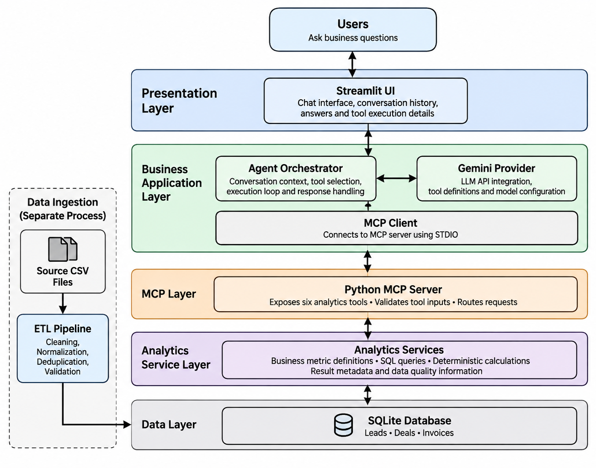
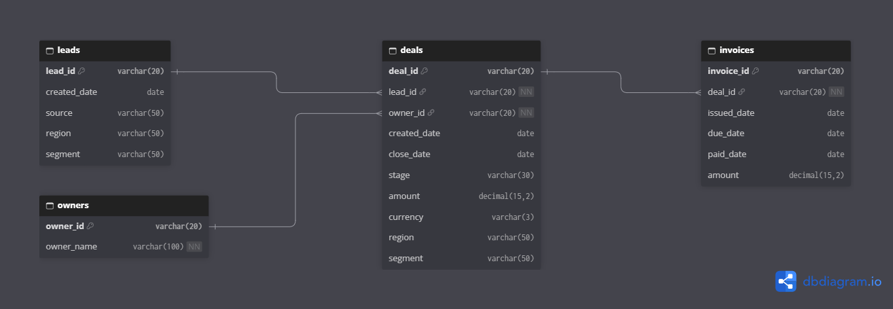
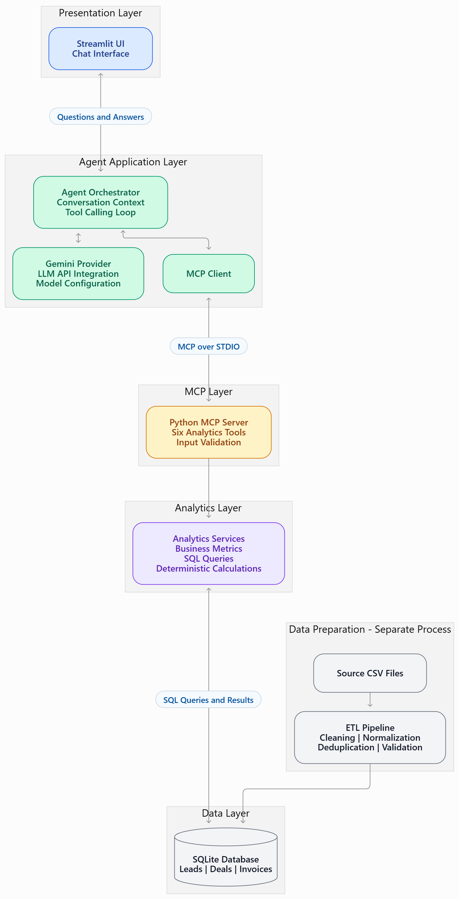

# AI Business Analyst – Technical Documentation

## 1. Introduction

The AI Business Analyst is a proof-of-concept application that allows users to ask business-related questions in natural language and receive data-driven insights from CRM data.

The application uses an LLM-powered agent to understand user questions, identify the relevant analytical capabilities, invoke tools and explain the results in a business-friendly format.

The solution is designed around the following principles:

- **Accuracy:** Business metrics are calculated using predefined SQL queries and deterministic Python logic rather than generated by the LLM.
- **Explainability:** Tool calls and their outputs can be inspected to understand how an answer was produced.
- **Separation of concerns:** User interface, agent orchestration, tool integration, analytics and data storage are maintained as separate components.
- **Honesty:** The agent should communicate data limitations, assumptions and cases where the available data is insufficient.
- **Model independence:** The LLM integration is isolated from the analytics and MCP layers, allowing the model provider to be changed with minimal architectural changes.

## 2. Overall Architecture

The application follows a layered architecture consisting of a presentation layer, business application layer, MCP layer, analytics service layer and data layer.

*Figure 1: Overall application architecture.*

The architecture also includes a separate data ingestion process responsible for preparing the source CSV files before they are used by the application.

### 2.1 Architecture Layers

| Layer / Component | Technology | Responsibility |
|---|---|---|
| Presentation Layer | Streamlit | Provides the chat interface, accepts user questions and displays analytical responses and execution details. |
| Business Application Layer | Python, Gemini API | Manages conversation context, interprets questions, selects analytical tools and coordinates their execution. |
| MCP Client | Python MCP SDK | Connects the agent application to the MCP server, discovers available tools and invokes them. |
| MCP Layer | Python MCP SDK | Exposes analytical capabilities as MCP tools, defines input schemas and validates tool requests. |
| Analytics Service Layer | Python, SQL, Pandas | Implements business metric definitions, executes analytical queries and returns structured results with relevant metadata. |
| Data Layer | SQLite | Stores the structured CRM data used by the analytics services. |

### 2.2 Data Ingestion Architecture

Data ingestion is a separate process from the agent's question-answering workflow.

The three source CSV files are processed through an ETL pipeline before being loaded into the SQLite database.

**Source files:**
- `leads.csv`
- `deals.csv`
- `invoices.csv`

**ETL responsibilities:**
- Load the source CSV files.
- Normalize date fields and handle inconsistent date formats.
- Identify and remove exact duplicate records where appropriate.
- Handle missing and inconsistent values according to documented assumptions.
- Validate the data and relationships before loading it into the database.

The resulting database contains the structured `leads`, `deals` and `invoices` tables.

### 2.3 Database Design

The application uses a relational database consisting of three
primary business entities: Leads, Deals and Invoices.

The database also includes an Owners entity to maintain deal
ownership information.

The Entity Relationship Diagram illustrates the tables,
their attributes, primary keys, foreign keys and relationships.

*Figure 2: Entity Relationship Diagram.*

## 3. Component Responsibilities

### 3.1 Streamlit UI

The Streamlit application provides the user-facing interface.

Its responsibilities include:
- Accepting business questions in natural language.
- Displaying the conversation between the user and the AI analyst.
- Maintaining conversation history within the application session.
- Displaying the generated analytical responses.
- Providing access to tool execution details, including tool names, input arguments and returned results.
- Allowing users to clear the conversation.

The UI does not contain business metric calculations or database query logic. It communicates with the agent orchestrator.

### 3.2 Agent Application

The agent application coordinates the interaction between the LLM and the analytical tools.

It consists of the following components:

**Agent Orchestrator**

The orchestrator manages the agent execution loop.

Its responsibilities include:
- Maintaining conversation context.
- Sending the user question, system instructions and available tool definitions to the LLM.
- Receiving and interpreting LLM responses.
- Identifying requested tool calls.
- Invoking the corresponding MCP tools.
- Passing tool results back to the LLM.
- Repeating the tool-calling cycle when additional analysis is required.
- Returning the final response along with tool execution details.

**Gemini Provider**

The Gemini provider encapsulates communication with the Gemini API.

Its responsibilities include:
- Connecting to the configured Gemini model.
- Converting MCP tool definitions into the format expected by the Gemini API.
- Sending prompts and tool results to the model.
- Processing model responses and function calls.
- Supporting model configuration through environment variables.

This separation keeps model-specific integration logic outside the orchestrator and analytics services.

**MCP Client**

The MCP client establishes communication with the Python MCP server using the STDIO transport.

It is responsible for:
- Establishing the MCP connection.
- Discovering available tools.
- Sending tool invocation requests.
- Receiving tool execution results.

### 3.3 Python MCP Server

The MCP server exposes the application's analytical capabilities through the Model Context Protocol (MCP).

It acts as the interface between the agent application and the analytics service layer.

Its responsibilities include:
- Registering and exposing analytical tools.
- Providing tool descriptions and input schemas.
- Validating incoming tool arguments.
- Routing requests to the appropriate analytics services.
- Returning structured results to the MCP client.

The MCP server does not perform LLM orchestration or independently generate business insights.

### 3.4 Analytics Service Layer

The analytics service layer contains the actual business logic of the application.

It is responsible for:
- Implementing documented business metric definitions.
- Executing predefined SQL queries against the SQLite database.
- Performing deterministic calculations using Python.
- Applying relevant filters, date ranges and dimensions.
- Returning structured results, supporting metadata and data quality information.

The analytics layer is independent of both the LLM provider and the MCP protocol. This allows the same analytical capabilities to be exposed through other interfaces in the future.

### 3.5 SQLite Database

SQLite stores the structured CRM data used by the application.

The database contains three primary tables:

- **Leads:** Lead-related information, including creation date, source, region and segment.
- **Deals:** Deal-related information, including creation date, closing date, stage, amount, currency, region, segment and owner.
- **Invoices:** Invoice-related information, including issue date, due date and payment date.

The database schema and relationships are documented in the Entity Relationship Diagram and data dictionary.

Refer to:
- `images/data-er-diagram.png`
- `data-dictionary.md`

## 4. End-to-End Execution Flow

The following sequence describes how a natural-language business question is converted into an analytical response.

### Step 1: User submits a question

The user enters a business question through the Streamlit chat interface.

Example:

"What was the total revenue last quarter, and how does it compare to the quarter before?"

### Step 2: Question is passed to the agent

Streamlit forwards the question to the Agent Orchestrator.

The orchestrator maintains the conversation context and prepares the request using the system instructions and available analytical tool definitions.

### Step 3: LLM interprets the question

The Gemini model identifies the business intent, relevant metric, time periods and analytical dimensions.

It determines which analytical tool or combination of tools is required to answer the question.

### Step 4: LLM requests an analytical tool

The LLM returns a function call containing the selected tool name and its input arguments.

The following diagram illustrates the interaction between
the application components during question processing.

*Figure 3: End-to-end application execution flow.*

For example, it may request the quarterly revenue comparison tool with the required quarter and revenue type parameters.

### Step 5: MCP client invokes the tool

The Agent Orchestrator passes the tool request to the MCP client.

The MCP client communicates with the Python MCP server through the STDIO transport.

### Step 6: MCP server routes the request

The MCP server validates the input arguments and invokes the corresponding analytics service.

### Step 7: Analytics service processes the request

The analytics service executes the required SQL queries against SQLite and performs the predefined business calculations.

The result is returned with relevant supporting information, such as sample sizes, filters, evaluation periods and data quality notes where available.

### Step 8: Results are returned to the LLM

The analytics results are passed back through the MCP client and Agent Orchestrator to Gemini.

If further analysis is required, the model may request additional tool calls.

### Step 9: LLM generates the final response

Once the required tool results are available, Gemini interprets the findings and generates a natural-language business response.

The response should communicate relevant findings, comparisons, caveats and limitations without introducing unsupported numerical claims.

### Step 10: Streamlit displays the response

The Agent Orchestrator returns the final answer and execution trace to Streamlit.

The UI displays:
- The final analytical response.
- The model used.
- Expandable tool execution details, including tool names, arguments and returned results.

This makes the analytical process inspectable and helps users understand the source of the generated insights.

## 5. Available Analytical Tools

The MCP server currently exposes six analytical tools.

| Tool | Purpose |
|---|---|
| `get_quarterly_revenue_comparison` | Compares quarterly commercial revenue using the selected revenue measure, currency and optional filters. |
| `get_win_rate_analysis` | Analyses win rates across business dimensions such as region or segment, with optional filters. |
| `diagnose_win_rate_change` | Analyses changes in win rate between two quarters and separates rate and composition effects. |
| `get_payment_speed_analysis` | Analyses invoice payment duration and payment delays across business dimensions. |
| `get_outstanding_receivables` | Analyses unpaid and overdue receivables as of a specified evaluation date. |
| `get_executive_scorecard` | Provides a consolidated view of commercial performance, sales efficiency, pipeline health and collection efficiency. |

The tools use predefined analytical logic. The LLM is responsible for selecting the appropriate tools and explaining their results, not independently calculating the underlying business metrics.

Detailed metric definitions and assumptions are maintained in `metrics-definitions.md`.

## 6. Key Design Decisions

### 6.1 Custom Python Agent Orchestration

A custom Python orchestration loop was implemented instead of introducing an additional agent framework.

This provides direct control over:
- The LLM interaction cycle.
- Tool discovery and execution.
- Conversation context.
- Error handling and execution limits.
- Tool execution tracing.

For the current POC, this approach keeps the implementation lightweight and avoids unnecessary abstractions.

### 6.2 Model Provider Separation

The Gemini integration is isolated in a separate provider component.

Model configuration is maintained through environment variables rather than being embedded throughout the application.

This reduces dependency on a particular LLM provider and makes future provider integration easier.

### 6.3 Model Context Protocol (MCP)

MCP was selected to standardize communication between the agent and the analytical tools.

The MCP server exposes analytical capabilities independently of the agent orchestration logic.

This separation allows the same analytical tools to be consumed by other MCP-compatible clients in the future.

### 6.4 STDIO Transport

The MCP client communicates with the MCP server through STDIO.

This was selected because the POC runs locally and does not require a separately hosted MCP service or network endpoint.

### 6.5 SQLite Database

SQLite was selected as the relational database because it is lightweight, requires minimal setup and is sufficient for the scale and local execution requirements of this POC.

### 6.6 Deterministic Analytics

Business metrics are implemented using predefined SQL queries and Python calculations rather than relying on LLM-generated SQL or model-based numerical calculations.

This approach improves consistency, reproducibility and traceability of analytical results.

### 6.7 No RAG or Vector Database

A retrieval-augmented generation architecture was not introduced because the primary data consists of structured relational CRM records.

Predefined analytical tools provide a more direct and controlled approach for answering the required business questions.

## 7. Known Limitations

The POC has the following limitations:

### Data Limitations

- Owner names are the only available owner identifiers. Records with identical names are assumed to represent the same owner.
- Some deal records have missing amounts, which limits

## 8. References and Resources

The following resources were referred to during the research and design of the application:

1. **AI Agents Explained – HatchWorks AI**  
   https://hatchworks.com/blog/ai-agents/ai-agents-explained/  
   Used for understanding AI agents and their architecture.

2. **AI Agents Whitepaper**  
   https://www.unidigital.news/wp-content/uploads/2025/01/Newwhitepaper_Agents2.pdf  
   Referred to during research on AI agent concepts and architecture.

3. **Salesforce Help – CRM Terminology**  
   https://help.salesforce.com/s/articleView?id=000387867&type=1  
   Used as a reference for CRM-related terminology.

4. **Salesforce Help – CRM Analytics Terminology**  
   https://help.salesforce.com/s/articleView?id=analytics.bi_app_sales_wave_terminology.htm&type=5  
   Used as a reference for business intelligence and analytics terminology.

## 9. Supporting Project Documentation

The following documents and diagrams provide additional implementation details:

- `data-dictionary.md` – Database tables, columns, data types and constraints.
- `metrics-definitions.md` – Business metric definitions, calculation logic and assumptions.
- `images/architecture.jpeg` – Overall application architecture.
- `images/mermaid-diagram.png` – End-to-end application flow.
- `images/data-er-diagram.png` – Database Entity Relationship Diagram.